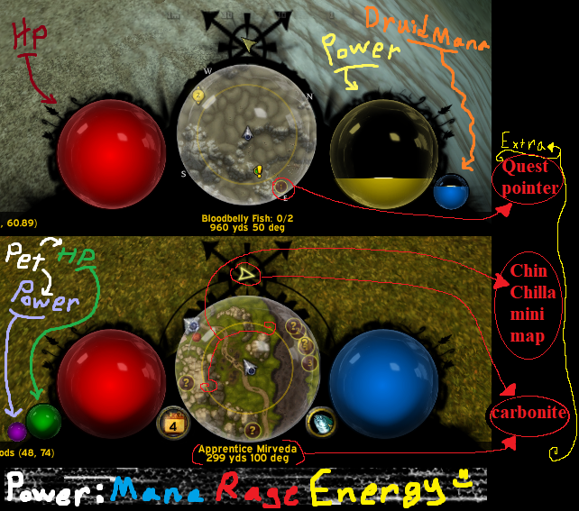
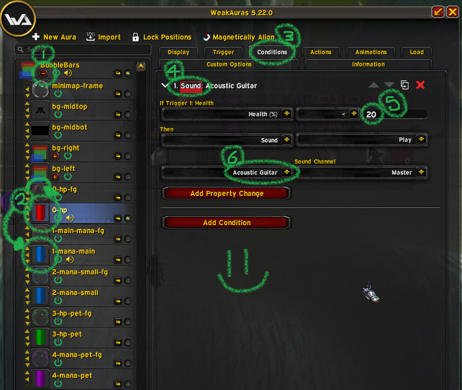

## BubbleBars WotLK WeakAuras

HP, Power(Mana, Rage...) as Bubbles

### Demo



### Installation

Copy `bubblebars` folder into  `{YOUR_WOW_LOCATION}\Interface\AddOns\WeakAuras\PowerAurasMedia\Auras`

> If there is no path like that, just make it


```
{YOUR_WOW_LOCATION}\Interface\AddOns\WeakAuras\PowerAurasMedia\Auras\bubblebars\{bubble.tga and others are here}
```

Copy all random texts inside `./bubble-bars-wotlk-wa.txt` file

Open Your WoW:WotLk (+Addon WeakAuras-wotlk https://addons.wago.io/addons/weakauras  ) and login

Type `/wa` and enter

Click `Import` button top of WA window

Paste

Import

Done


> Change your minimap position and layer too... (I used ChinChillaMinimap: https://www.curseforge.com/wow/addons/chinchilla/files/all?page=1&pageSize=20&version=3.3.5&showAlphaFiles=hide )

### Change Sounds


